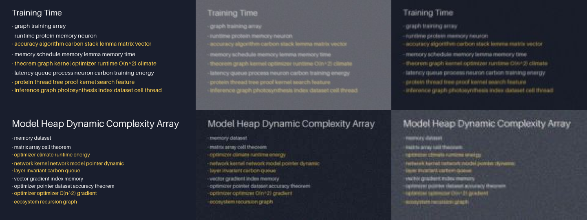

# BoardLens

An Android app that helps low-vision students read the board, slides and whiteboard from anywhere in a lecture hall. The phone camera locks onto the board, corrects perspective, enhances the text and shows it again in large, high-contrast type or reads it aloud. Everything runs on the device; no frame leaves the phone.

The research question: **how much does a learned multi-frame super-resolution stage reduce OCR error on far-away lecture text, at a latency a phone can sustain?** The MVP uses off-the-shelf on-device tools; each stage is then replaced by a trained model and measured against that baseline in CER/WER by distance.



## Status

| Stage | Baseline (MVP) | Planned replacement |
|---|---|---|
| 1. Capture | CameraX, ~2.7 MP analysis frames, linear zoom | Optical tele lens selection |
| 2. Stabilize | Blur gate (skip frames much blurrier than recent ones) + ORB/homography board tracking | Learned tracker, gyro fusion |
| 3. Region + rectify | OpenCV quad detection proposes corners, user adjusts on a frozen frame; OpenCV homography | Learned board detector, tracking |
| 4. Text detection | Whole region | Text-box detector (crop before SR) |
| 5. Enhance | Bicubic upscale to 1600 px long side (toggle: none) | **Multi-frame SR (`ml/`)** |
| 6. OCR | ML Kit on-device Latin | — |
| 7. Output | Large text, high contrast/invert, TTS, slide-change cue, full-text view | Re-rendered layout |

## App

- **Main screen**: camera card with the board outline and zoom, a reading card with the recognized text, and four large tiles (Read aloud / Stop, Freeze, Select or adjust board, Text size). Portrait, landscape and unfolded foldables each get their own arrangement.
- **Full text**: tap the reading card to read the text on a full screen; it holds still while live reading continues, and can be copied or read aloud.
- **Options** (gear button): text size, high contrast (the whole app turns yellow on black), invert, sharpen, read new slides aloud, whole-view reading. Settings persist across launches.
- **Accessibility**: text sizes in sp (they follow the phone's font-size setting), touch targets of 48 dp or more, contrast of at least 4.5:1, content descriptions on every control, system Back undoes one view change at a time.
- **Look**: Toss-style cards on a grey ground with one blue accent. One typeface (Pretendard) and one icon set (Tossface); details in [docs/design.md](docs/design.md).

## Repository layout

```
app/    Android app (Kotlin, Jetpack Compose, CameraX, OpenCV, ML Kit, LiteRT)
data/   boardlens_data: synthetic slides, degradation chain, slide-frame alignment
ml/     boardlens_ml:   CER/WER metrics, SR model, training, LiteRT/ONNX export
docs/   design notes, data-collection protocol, experiment logs
tests/  Python tests (pytest); Android unit tests live in app/src/test
tools/  Algorithm prototypes and simulations (e.g. tools/tracking/simulate.py),
        tools/tossface: pinned list and fetch script for the icon files
```

## Getting started

### Android app

Requirements: Android Studio with AGP 9.4 support, JDK 17+, a physical phone (the emulator camera is not useful for this).

```bash
./gradlew :app:installDebug      # or Run in Android Studio
./gradlew :app:testDebugUnitTest
adb logcat -s BoardLens/Perf     # per-stage latency, one line per processed frame
```

The Tossface icons in `app/src/main/assets/tossface` must stay byte-identical to the originals (see [Credits](#credits)). `TossfaceAssetsTest` checks this. If it fails, or to add an icon (append it to `tools/tossface/manifest.txt` first), run:

```powershell
powershell -ExecutionPolicy Bypass -File tools\tossface\fetch_tossface.ps1
```

### Python (data, training, evaluation)

```bash
python -m venv .venv && source .venv/bin/activate
pip install -e ".[dev]"            # add ,train for PyTorch, ,pdf for slide PDFs
pytest

bl-render-slides --out data/synth/clean --n 500
bl-make-pairs   --clean data/synth/clean --out data/synth/pairs --burst 5 --fixed-scale 4
bl-train-sr     --data data/synth/pairs --scale 4 --frames 5 --epochs 50 --out runs/sr_x4_b5
bl-export       --ckpt runs/sr_x4_b5/best.pt --out app/src/main/assets/sr_x4.tflite   # needs litert-torch
bl-gt           --eval data/real/eval --pdf lecture.pdf --out data/real/gt.jsonl   # needs [pdf]
bl-eval         --gt data/real/gt.jsonl --pred data/real/eval --by variant distance_m
```

## Evaluation

Primary metric is character error rate (CER) of ML Kit OCR on the phone, baseline vs. enhanced, broken down by viewing distance. The full capture → ground truth → scoring workflow is in [docs/evaluation.md](docs/evaluation.md). Secondary: per-stage latency, FPS, battery and thermal behavior on a named device. PSNR is logged during training but does not decide anything: a model can improve PSNR while making text harder to read. See [docs/design.md](docs/design.md).

## Privacy

No `INTERNET` permission. Real classroom data is collected only under [docs/data-collection.md](docs/data-collection.md): instructor permission, no faces, slides only.

## Credits

- **Tossface** by Toss Team: the app's icons. BoardLens에는 토스팀에서 제공한 토스페이스가 적용되어 있습니다. Bundled unmodified; license in `app/src/main/assets/licenses/tossface_license.txt`, copyright notice at [toss.im/tossface/copyright](https://toss.im/tossface/copyright).
- **Pretendard** by Kil Hyung-jin: the app's typeface, SIL Open Font License 1.1 (`app/src/main/assets/licenses/pretendard_ofl.txt`).
- **AndroidSVG** (Apache License 2.0) draws the icons; ML Kit, OpenCV and AndroidX under their own licenses.

The app icon is original artwork for BoardLens (it is not a Tossface emoji).
